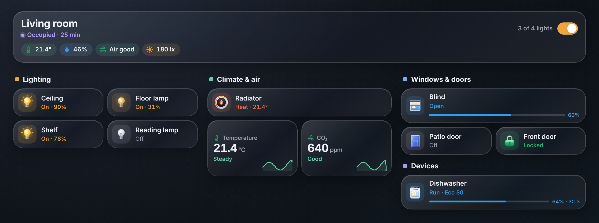
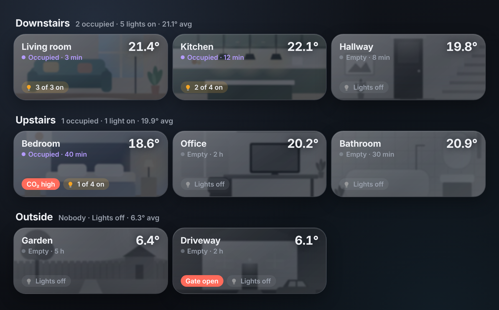

# Moments

Building blocks for Home Assistant dashboards, on phones, tablets, wall panels and desktops. Moments adds cards, animated device icons, a theme and backdrops. You compose them into your own dashboards, views and sections, mixed with any stock cards. Moments does not create a dashboard for you.





A good place to start is a **Home** view of your areas grouped by floor, each opening an **area view** that follows the same sections in every area. [examples/home.yaml](examples/home.yaml) has both, ready to paste.

## Requirements

- Home Assistant 2025.1 or newer
- Any device that runs the Home Assistant app or a modern browser

## 1. Install

### Option A: from Home Assistant

1. Add `https://github.com/westonfleming/ha-moments` as a custom repository of type **Dashboard**, then find **Moments** and choose **Download**.
2. Reload the page when asked. The dashboard resource is added for you.

Only full releases show up by default. Pre-releases (betas) appear once you enable beta versions for Moments.

### Option B: Manual

1. Download `ha-moments.js` from the latest [release](https://github.com/westonfleming/ha-moments/releases).
2. Copy it to `/config/www/ha-moments.js` on your Home Assistant (the **File editor** or **Samba share** add-on both work on an HA Green). Create the `www` folder if it doesn't exist, then restart Home Assistant once so it serves the folder.
3. Go to **Settings → Dashboards → ⋮ → Resources → Add resource**. If you don't see Resources, turn on **Advanced mode** in your user profile first.
4. Enter URL `/local/ha-moments.js?v=0.3.0`, type **JavaScript module**, and save.

To update a manual install, replace the file and bump the `?v=` number in the resource URL so the apps fetch the new version.

## 2. Compose a dashboard

1. In **Settings → Areas, labels & zones**, put your areas on floors (for example Downstairs, Upstairs and Outside) and give each area a picture if you like.
2. Go to **Settings → Dashboards → Add dashboard → New dashboard from scratch**, name it and open it.
3. Choose **✎ Edit → ⋮ → Raw configuration editor**, paste [examples/home.yaml](examples/home.yaml), replace the made-up ids, and save. From then on the visual editor works too.

**Home view.** One section per floor: a `moments-floor-heading`, then a `moments-area` card for each area. On a tablet or desktop the floors sit side by side; on a phone they stack.

**Area views.** Every area uses the same sections in the same order, so you always know where to look. Leave out a section the area has nothing for:

| Section | Cards |
| --- | --- |
| Header (full width) | `moments-area-header`: presence, readings, alerts, all-lights switch |
| Lighting | `moments-tile` per light, `moments-area-moments` for the area's default and moments |
| Climate & air | `moments-tile` for the thermostat, `moments-metric` for temperature, humidity, CO₂ and light |
| Windows & doors | `moments-tile` for blinds (with `progress: position`), doors and locks |
| Devices | `moments-tile` for appliances, plugs, fans and media |

An area card opens the view whose path is its area id, so give each area view `path: <area id>`. [examples/tabs.yaml](examples/tabs.yaml) has more views (Now, Weather & climate, Status) built from the other cards.

## 3. Make it the default on each device

1. Open the new dashboard from the sidebar.
2. Open your profile (your user name at the bottom of the sidebar) and under **Dashboard** choose the new dashboard. This makes it the default on that device only.
3. If a card shows "Custom element doesn't exist", the device still has the old frontend cached. In a browser, do a hard refresh. In the Home Assistant app, use **Reset frontend cache** in the app's settings, then reopen the app.

## The cards

| Card | Shows | Needs |
| --- | --- | --- |
| `moments-tile` | One device: a state-aware Moments icon, name and state, plus optional programme, metrics, progress bar and finish time | Any entity |
| `moments-metric` | One reading, value first: number, status word (e.g. CO₂ Good, Humidity Comfortable, temperature trend) and a sparkline | A sensor |
| `moments-area-header` | Top of an area view: name, presence, temperature, humidity, air and light chips, red alert chips and an all-lights switch | An area |
| `moments-area` | An area for the home view: name, presence, temperature, lights on and alerts, over a faded photo. Taps open the area's view | An area |
| `moments-floor-heading` | A floor's name and "2 occupied · 5 lights on · 21.2° avg" | A floor (or a list of areas) |
| `moments-header` | Greeting, time, weather, indoor temperature | A weather entity (optional) |
| `moments-chips` | Alerts only when something needs you | Nothing |
| `moments-area-moments` | An area's default and the moments that override it, as chips | Scenes, scripts or automations |
| `moments-on-now` | Everything on or open, with one-tap off | Nothing |
| `moments-schedules` | Scheduled automations you can adjust | See [examples/schedules.yaml](examples/schedules.yaml) |
| `moments-weather` | Today in detail, then 7 days: condition icon, rain (mm), wind and gusts, low–high bar | A weather entity with a daily forecast |
| `moments-temperatures` | Indoor and outside: now, today's range, trend, 24-hour chart | Temperature sensors |
| `moments-daylight` | Today's outdoor light (log scale) against your dark line, and when it got dark | An outdoor lux sensor |
| `moments-internet` | Online status, speeds, a 7-day chart and recent outages | Ping integration (online) and Speedtest integration (speeds) |
| `moments-appliance` | Program, progress and finish time, then recent runs (with kWh from a plug) | E.g. the Home Connect integration |

Every option is in [examples/cards.yaml](examples/cards.yaml). The charts and logs read Home Assistant's history, which keeps 10 days by default. For a 30-day outage log or longer run history, raise it in `configuration.yaml`:

```yaml
recorder:
  purge_keep_days: 90
```

### Area moments

Each area has a default: what its lights do on their own, such as a time-of-day Hue scene or a motion automation. Some areas also have moments that override it for a while, such as Movie or Bedtime. `moments-area-moments` shows them as chips under the area's lights: the default first, then the moments. One chip is lit at a time.

```yaml
type: custom:moments-area-moments
area: living_room
default:
  name: Natural
  run: scene.living_room_natural_light
moments:
  - name: Movie
    icon: mdi:movie-open
    run: scene.living_room_movie
  - name: Bedtime
    icon: mdi:bed
    run: [scene.living_room_nightlight, script.bedtime]
```

| Option | Description |
| --- | --- |
| `run` | What starts a moment: a scene, script, automation or button, or a list run in order. |
| `default` | The default chip's `name`, `icon` and `run` (or just a run target). Without `run`, the chip turns the area's lights on. |
| `lights` | Lights a moment sets, on a moment or on the card. Found from the moment's scene (its members or Hue room), then the area, otherwise. |
| `active_entity` / `active_state` | For a moment the lights can't tell: active while this entity is `on` (or `active_state`; for a select, the option with the moment's name). |
| `dynamic` | The moment changes its lights by itself, so only switching them off ends it. Hue dynamic scenes are detected. |
| `show_default` | `false` hides the default chip. |

A moment is active while its lights are on and nobody has adjusted or switched them since it started, while its script runs, or while `active_entity` says so. Running the default ends it. Tapping a lit chip, moment or default, turns it off: its running scripts stop and its lights go off. An area with moments but no default shows just the moments, and an area with only a default shows nothing.

### Schedules and time of day

Without a helper, the clock decides the time of day (morning 05:00, day 11:00, evening 17:00, night 22:00). To control it yourself, create a **Dropdown** helper named `time_of_day` with the options `morning`, `day`, `evening` and `night`, set it from an automation, and pass `time_of_day_entity` to the cards. [examples/time-of-day.yaml](examples/time-of-day.yaml) has a ready-made helper and automation, and [examples/schedules.yaml](examples/schedules.yaml) the helpers behind `moments-schedules`.

### The Moments theme

The cards look right in any theme. To give the whole dashboard, stock cards included, the dark Moments look:

1. Copy [themes/moments.yaml](themes/moments.yaml) to `/config/themes/moments.yaml`.
2. Make sure `configuration.yaml` has `frontend:` → `themes: !include_dir_merge_named themes`, then restart once (later changes only need **Developer tools → Actions → `frontend.reload_themes`**).
3. Set `theme: moments` on each view, as [examples/tabs.yaml](examples/tabs.yaml) does, or pick **Moments** as your theme in your profile.

### Tiles: icons, surfaces and backdrops

`moments-tile` draws one of 16 animated icon sets (light, lock, door, blind, thermostat, plug, fan, coffee, washer, dishwasher, dryer, fridge, freezer, light sensor, motion, temperature), picked from the entity or set with `icon_set`. Each icon shows the entity's state, and it only moves while the device is active. Motion stops when Reduce Motion is on. Blinds have an icon for every 10% step: a position rounds up to the next step, and the shade glides between steps.

Everything beyond `entity` is optional, and anything a device can't report is simply left out:

| Option | What it does |
| --- | --- |
| `icon_set` | Which icon to draw. Default: from the entity's domain and device class. |
| `icon_style` | `glow` (default) or `crisp`. Theme default: `moments-icon-style`. |
| `states` | Maps the device's own state words onto the icon's states, e.g. `running: [Run, DelayedStart]`. |
| `secondary` | An entity (e.g. the programme) or plain text after the state. |
| `metrics` | Entities whose values join the state line, e.g. power and energy. |
| `progress` | A 0–100 entity, or `position` for a cover. Draws a bar only when set. |
| `finish` | A timestamp entity shown beside the bar. |
| `surface` | `solid`, `frosted` or `glass`. Theme default: `moments-tile-surface`. |
| `opacity`, `blur` | How much card colour shows (0–1) and the blur in px. Theme defaults: `moments-tile-opacity`, `moments-tile-blur`. |
| `tap_action` | `more-info` (default), `toggle` or `none`. |

### Metrics and area headers

`moments-metric` shows one reading. Its status word comes from `levels`, a list of `{ below, label, color }` where `color` is `good`, `fair`, `poor`, `info` or any CSS colour. Humidity, CO₂, PM2.5 and light have sensible defaults; temperature shows its trend instead. `sparkline` sets the hours of history (default 24, `false` hides it) and `decimals` the precision.

`moments-area-header` needs only `area`. It finds the area's temperature, humidity, air quality, light and presence sensors, its lights and its leak, smoke, gas and problem sensors. Set any of `temperature`, `humidity`, `air`, `illuminance` or `presence` to another entity, or to `false` to hide it. `lights` and `alerts` take a list or `false`, and `show` picks which readings appear and in what order. Alerts and high CO₂ appear as red chips. Both cards take the same `surface`, `opacity` and `blur` as tiles.

### Areas and floors

`moments-area` takes the same `area` options as the area header. Its photo is the area's picture from **Settings → Areas**, or set `image` to any URL (`false` hides it). The photo is faded so the text stays readable:

| Option | What it does |
| --- | --- |
| `image_style` | `wash` (default): the card colour over the whole photo. `edge`: the photo fades in on the right. `full`: the whole photo with light text on a shade. `none`: no photo. |
| `image_strength` | 0–1, how much photo shows in `wash` and `edge`. Default 0.3. |
| `dim_when_empty` | Turns the photo grey while nobody is there. Default `true`. |
| `navigation_path` | The view a tap opens. Default: the area id, so name each area view's path after its area. `false`: no tap. |

`moments-floor-heading` takes `floor` (a floor id from **Settings → Areas → Floors**) or `areas`, plus `name` and `summary: false` to hide the line.

Each release also includes eight backdrops (`mist`, `aurora`, `horizon` and `contour`, each in `-light` and `-dark`). Copy them to `/config/www/moments/backdrops/` and set `lovelace-background` in a theme mode, as the comments in [themes/moments.yaml](themes/moments.yaml) show. Glass tiles look best on a backdrop.

## Uninstall

Remove the Moments cards from your dashboards, then remove Moments where you installed it (or delete `/config/www/ha-moments.js` and its resource for a manual install).

To deploy a test build and check it on your devices, see [TESTING.md](TESTING.md). Development notes are in [CONTRIBUTING.md](CONTRIBUTING.md).
